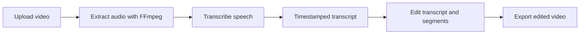

# Rogue Text


**Edit spoken video by editing its transcript.**

Rogue Text is an AI-assisted video editing prototype. It transcribes speech with timestamped words, lets a user work with the transcript, and rebuilds the selected video segments into an exported edit.

<p align="center">
  
</p>

## Demo

### [Watch the Rogue Text demo video](demo/rogue-text-demo.mp4)

The demo above shows the authentic project workflow supplied with this repository.

## How it works



## Features

- Upload MP4, AVI, or MOV video
- Transcribe with Whisper Timestamped or Deepgram
- Detect and represent silent sections
- Edit video through timestamped transcript data
- Preview the editing workspace in the browser
- Export MP4, AVI, or MOV output at multiple resolutions
- Generate a suggested title with Groq

## Tech stack

- Flask and Jinja templates
- OpenAI Whisper and Whisper Timestamped
- Deepgram speech-to-text option
- MoviePy and FFmpeg for media processing
- Groq for title generation
- HTML, CSS, and JavaScript editing interface

## Run locally

Requirements: Python 3.10+ and FFmpeg installed on your system.

```bash
git clone https://github.com/kushalsai09/ROGUE-TEXT.git
cd ROGUE-TEXT
python -m venv .venv
source .venv/bin/activate
pip install -r requirements.txt
cp .env.example .env
python app.py
```

Add your own API keys to `.env` if you want to use Deepgram transcription or Groq title generation. Whisper transcription runs locally after its model is downloaded.

Then open `http://127.0.0.1:5000`.

## Project structure

```text
ROGUE-TEXT/
├── app.py                         # Flask routes and video pipeline
├── revised_silence_detection.py  # Silence detection helper
├── templates/                    # Upload and editing interfaces
├── static/                       # Styles, scripts, and branding
├── uploads/                      # Local processing workspace
├── demo/                         # Portfolio demo video
└── requirements.txt
```

## Security

Keep `.env` private and never commit API keys. The included `.env.example` documents the required variables without containing credentials.

## Status

Rogue Text is a portfolio prototype, not a production-hosted editing service. Large video files and generated media are intentionally excluded from normal source control, apart from the curated demo.
